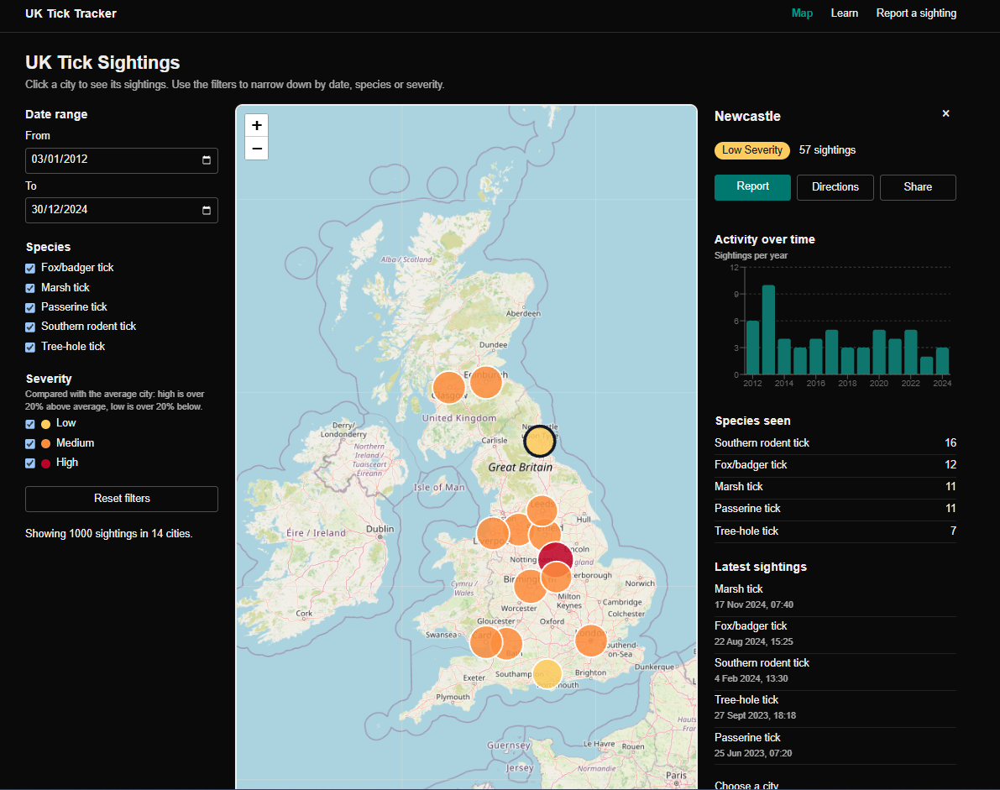

# UK Tick Tracker

By Ibraheem Kasim, for the Elanco Placement Programme technical task (Frontend).

A web app that shows where ticks have been seen across the UK, teaches people how to avoid them, and lets anyone report a sighting.

**Live site:** https://uk-tick-tracker.vercel.app

**Video walkthrough:** (YouTube link to be added)

## Features

The web app contains three pages, linked by a menu bar: Map, Learn and Report a sighting.

### Interactive map

- **Map:** a circle for each of the 14 cities. Bigger means more sightings; colour shows severity.
- **Hover details:** city name, amount of sightings, severity, most common tick species and latest date and an option to click for extra details.
- **Filters:** date range, species and severity, with a live count and a reset button.

### Sighting information

- **Side panel:** click a city to see its severity, a sightings-per-year timeline, species seen and the 5 latest sightings.
- **Quick actions:** Report, Directions via Google Maps and Share.
- **Sharing:** the selected city is saved in the address, e.g. `/?city=Leeds`.

### Education

- **Species guide:** Includes information about the 5 species in the data plus the sheep tick
- **Prevention tips:** Health and safety measures when it comes to ticks like how to remove and prevent ticks.
- **Seasonal chart:** Sightings per month, with dropdown options for city and year.

### Report a sighting

- **Form:** includes date, time, nearest city, species, notes and a photo option.
- **Validation:** errors such as entering a future date will not be sent, warnings ask you to double check, and a success message when a valid report is inputted.
- **Database:** submitted reports and photos are saved in a database via Supabase.

## How to run it

**Easiest:** open the live site at https://uk-tick-tracker.vercel.app. Nothing to install.

To run it on your own computer (needs Node.js 20 or newer):

1. `git clone https://github.com/IbraheemK408/tick-tracker.git`
2. `cd tick-tracker`
3. `npm install`
4. `npm run dev`, then open http://localhost:3000

The report form also needs a Supabase database. The steps are in `supabase/setup.sql`; without it, the Report page shows a “not set up” message.

## My choices

### Tech stack

- **Next.js + TypeScript:** pages and data caching built in.
- **Tailwind CSS:** quick styling and easy phone, laptop and wide-screen layouts.
- **Leaflet + OpenStreetMap:** a free interactive map with no account or API key needed.
- **Recharts:** React-friendly charts for the yearly and monthly bars.
- **Supabase:** a hosted database with photo storage and security rules, so I didn't need to build a backend.
- **Vercel:** free hosting that updates the live site on every push to GitHub.

### Handling the data

- **No coordinates:** the API only gives city names, so I added my own coordinates for the 14 cities.
- **No severity:** I defined it myself (see below).
- **Rate limit:** the API returns with an error if called too often, so the data is cached for a few hours.
- **API down:** the map shows a friendly error.

### How severity works

Each city is compared with the average city, using only the sightings that match the filters. More than 120% of the average is high severity meaning the colour would be red, less than 80% is low giving a yellow colour, and anything in between is medium and in orange. With all the data, the average city has 71 tick sightings, therefore over 85 is high and under 57 is low.

I used sighting numbers because the API and brief don’t indicate how to calculate severity, and using species would just repeat the species filter. I first tried calculating severity by splitting the cities into thirds, but then the top third was always high even when every city had a similar number which makes the severity incorrect, so I switched to comparing with the average so that there doesn’t have to be a set amount of severe or non severe cases.

### Other decisions

- **Colours:** yellow, orange and dark red therefore works for people with red/green colour blindness.
- **Circle size:** based on a square root, so twice the sightings means twice the area, not four times.
- **“Not sure” option:** most people can't tell species apart, so a forced guess would give wrong data.
- **Checks in two places:** the form gives friendly messages, and the database rejects invalid data too.
- **Security:** visitors can add and read reports, but never change or delete them.

## Accessibility

- **Labels:** every form field has one, and errors are announced to screen readers if needed.
- **Keyboard-friendly:** a dropdown works alongside clicking the map so you can choose a city using both the keyboard and clicking.
- **Colour and words:** severity colours are colour blind friendly and also labelled in words.
- **Layouts:** phone, laptop and wide screen, with light and dark mode all providing a working user interface.

## Findings and limitations

- **Severity may be inaccurate:** cities are compared with each other, not with a real-world risk level.
- **Reports not on the map:** they're saved, but kept separate from Elanco's data so the map doesn’t update as new reports come in.

## What I would improve

- Show community reports on the map, marked separately.
- Base severity on real risk data.
- Report limit so less risk of spam
- Exact locations with a map pin.

## Project structure

- `src/app`: the three pages and the shared layout.
- `src/components`: the map, details panel, charts and form.
- `src/lib`: data fetching, city coordinates, severity, Learn content and form rules.
- `supabase/setup.sql`: the database setup script.
